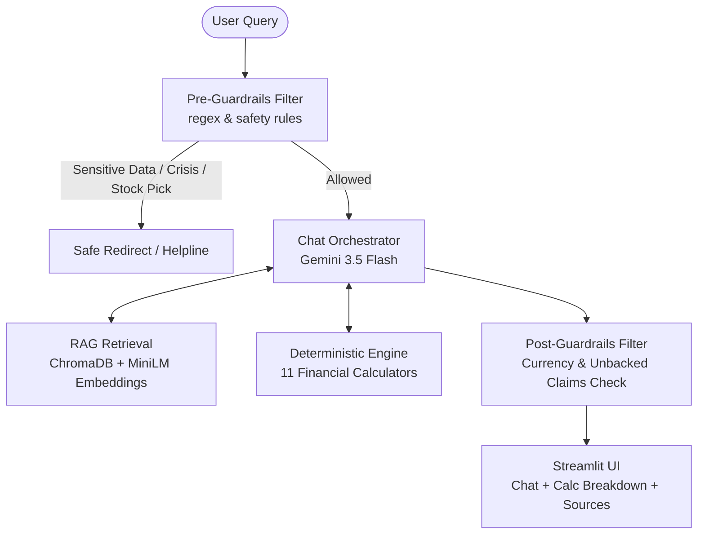

# 🪙 Artha — AI-Powered Financial Chatbot

A demo-ready, tested personal finance chatbot designed for everyday users in India.
Built with **Streamlit**, **Gemini API** native tool-calling, **ChromaDB** RAG, and pure deterministic calculators for zero arithmetic hallucination.

> **Live Application URL:** *[Deploy to Streamlit Community Cloud — Insert URL here]*

---

## 🏗️ Architecture



---

## ⚙️ Environment Variables & Secrets

Artha looks for configuration in:
1. **Streamlit Secrets** (`.streamlit/secrets.toml` or Streamlit Cloud Secrets)
2. **Environment Variables** / `.env` file

| Variable | Description | Default |
|---|---|---|
| `GEMINI_API_KEY` | Google AI Studio Gemini API Key | **Required** |
| `GEMINI_MODEL` | Active Gemini Model name | `gemini-3.5-flash` |
| `CURRENCY` | Locale currency code | `INR` |
| `CURRENCY_SYMBOL` | Currency symbol | `₹` |
| `MAX_MESSAGES_PER_SESSION` | Cost safeguard limit per session | `30` |
| `RAG_MIN_SCORE` | Similarity threshold for RAG docs | `0.35` |

---

## 💻 Run Locally

### 1. Clone & Install Dependencies
```bash
git clone <repo-url>
cd fin-chatbot
pip install -r requirements.txt
```

### 2. Configure Your API Key
Copy `.env.example` to `.env`:
```bash
cp .env.example .env
```
Edit `.env` and set your key:
```env
GEMINI_API_KEY=your_gemini_api_key_here
```

### 3. Launch App
```bash
streamlit run app.py
```
Open your browser at `http://localhost:8501`.

---

## ☁️ Deploy to Streamlit Community Cloud

1. Push this repository to your GitHub account on the `main` branch.
2. Sign in to [share.streamlit.io](https://share.streamlit.io/).
3. Click **"New app"** and select:
   - **Repository:** `your-username/fin-chatbot`
   - **Branch:** `main`
   - **Main file path:** `app.py`
4. Expand **Advanced settings > Secrets** and paste:
   ```toml
   GEMINI_API_KEY = "your_actual_gemini_api_key"
   ```
5. Click **Deploy!**

---

## 🧪 Testing & Verification

Run the full automated unit test suite (133 tests):
```bash
pytest tests/ -v
```

Run the benchmark evaluation harness (15 math calculations + 8 guardrails):
```bash
python eval/run_eval.py
```

---

## 💬 Example Conversations Supported

1. *"I earn 80k a month and my rent is 25k. How should I budget?"*
2. *"What's the EMI on a ₹40 lakh home loan at 8.7% for 20 years?"*
3. *"How long will it take to save ₹10 lakh if I put away ₹20,000 a month?"*
4. *"What's the difference between SIP and a lump-sum investment?"*
5. *"Which stock should I buy this week?"* *(Redirects safely to educational topics)*
6. *"I have a credit card at 36% and a personal loan at 14%. Which should I pay first?"*

---

## ⚠️ Limitations & Disclaimer

- **Educational Purpose Only:** Artha provides financial calculations and educational information only. It does not provide SEBI-registered personalized investment advice, stock picks, or chartered accounting opinions.
- **Market Risk:** Investment returns are assumed or projected based on historical baselines; actual market performance fluctuates and is not guaranteed.
- **Tax Rules:** Tax provisions (such as 80C, capital gains) are subject to changes in the Finance Act. Consult a Chartered Accountant for formal tax filings.
